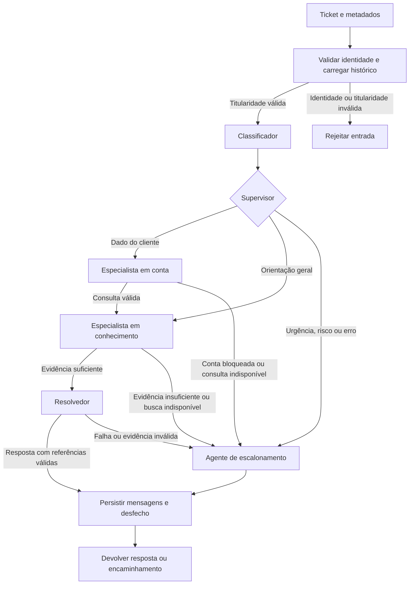

# Arquitetura do UDA-Hub

Proposta para revisão no contexto da [ROB-37](https://linear.app/deltaedgeai/issue/ROB-37). A primeira entrega atende tickets da CultPass em uma execução local. Ela responde com evidências da base de conhecimento e do cadastro quando necessário, ou gera um encaminhamento para suporte humano. A [matriz de aceite](aceite.md) define como demonstrar o comportamento descrito aqui.

## Escolha da arquitetura

O padrão proposto é **Supervisor**, com um `StateGraph` construído do zero em `agentic/workflow.py`. O supervisor aplica regras de roteamento sobre a classificação estruturada, os metadados e as evidências obtidas. Assim cada rota pode ser testada com entradas controladas e comparada com a rota observada em uma demonstração.

Um supervisor com delegação livre pelo modelo permitiria explorar mais caminhos. Para o conjunto inicial da CultPass, as categorias e os dois desfechos cabem em transições explícitas. As regras de risco e de consulta de dados ficam no código, enquanto os agentes interpretam a mensagem, selecionam evidências e redigem a resposta ou o resumo.

A demonstração usa a interface local e exemplos de chat e e-mail no mesmo contrato de entrada. O encaminhamento persiste a decisão para revisão humana na própria aplicação. Conectores externos, operações financeiras, alterações na CultPass e MCP ficam fora do recorte proposto.

## Agentes e fluxo

| Agente | Responsabilidade e fronteira |
| --- | --- |
| Classificador | Interpreta o texto e o contexto da conversa. Retorna categoria, intenção, complexidade e termos de busca estruturados. Categorias iniciais incluem acesso, assinatura e cobrança, reservas, suporte técnico e desconhecido. |
| Especialista em conhecimento | Busca artigos da conta pelo assunto, ordena os candidatos e entrega trechos, identificadores e pontuação de relevância. |
| Especialista em conta | Consulta o status da conta e da assinatura quando a intenção envolve dados do cliente autenticado na simulação. Entrega fatos estruturados ao resolvedor. |
| Resolvedor | Redige a resposta com base nos artigos recuperados. Quando a rota usa ferramenta, acrescenta os fatos retornados pela consulta autorizada e referencia o artigo que fundamenta a orientação. |
| Agente de escalonamento | Produz uma mensagem ao cliente e um resumo separado para suporte humano com motivo, ações tentadas e informações pendentes. |

O supervisor encaminha urgência alta, pedidos de ação sensível e solicitações explícitas de atendimento humano diretamente ao escalonamento. Perguntas gerais vão ao especialista em conhecimento. Consultas específicas da conta passam primeiro pelo especialista em conta, depois pela busca de artigos. Erro de ferramenta indispensável, falta de evidência e falhas de classificação ou geração resultam em escalonamento com motivo explícito. Se o modelo estiver indisponível, o agente de escalonamento gera o resumo a partir de um template com categoria, motivo e consultas realizadas.

## Contrato e estado

A entrada normalizada contém `account_id`, `ticket_id`, `turn_id`, texto, canal, urgência, data de recebimento e `external_user_id`. O `account_id` representa a organização atendida. Na demonstração local, o operador seleciona um perfil sintético pré-cadastrado. A interface mapeia o perfil à identidade da conta e do cliente fora da mensagem e injeta esse contexto no fluxo. Um ticket novo é vinculado a essa identidade. Ao retomar um ticket, o serviço confere o vínculo no UDA-Hub antes de carregar estado ou usar ferramentas. A interface rejeita perfis desconhecidos e tickets de outro titular. Um identificador escrito na mensagem é tratado como texto. Essa seleção simula a identidade fornecida por uma integração de atendimento.

O estado do grafo mantém a classificação, a rota, evidências, resultados de ferramentas e desfecho do turno atual, além das mensagens da sessão. Campos transitórios são reiniciados a cada turno. A saída traz `resolved` ou `escalated`, a resposta ao cliente, referências dos artigos utilizados, pontuação de relevância quando calculada e, para escalonamentos, o motivo e um resumo para suporte. Um erro de entrada ou de persistência é reportado à interface como erro operacional. Uma interrupção sem confirmação da gravação não é apresentada como ticket resolvido.

## Recuperação de conhecimento e confiança

O especialista consulta a tabela `Knowledge` por `account_id`. Para este corpus pequeno, a proposta é ordenar em memória por cobertura de termos normalizados em título, tags e conteúdo. O classificador fornece os termos informativos da intenção e pode expandir sinônimos previstos para as categorias. A pontuação de relevância é a fração entre os termos informativos distintos encontrados no artigo e o total de termos consultados. Empates privilegiam correspondências em título e tags e usam o identificador do artigo como último critério. Até três candidatos seguem com título, conteúdo, ID e pontuação.

O limiar inicial proposto é **0,60**, sujeito à calibração com os exemplos da rubrica. Uma consulta vazia ou sem candidatos tem pontuação zero. Abaixo do limiar, a rota é escalonamento. Para cada intenção identificada, o resolvedor aponta um artigo e um trecho literal que sustenta a orientação. O código confere que o artigo foi recuperado acima ou no limiar, que o trecho existe nesse artigo e que todas as intenções estão cobertas. Se só parte do pedido tiver evidência, o agente gera um encaminhamento com o ponto pendente. Os casos de aceite verificam também se os trechos apontados sustentam a orientação esperada.

O resolvedor recebe apenas os artigos recuperados e os fatos autorizados necessários ao caso. A resposta usa os trechos validados e os campos estruturados das ferramentas. Conteúdo de tickets, histórico e artigos é tratado como dado. A preferência inicial é o formato da resposta, conciso ou em passos, aplicado na renderização. Regras de atendimento vêm da base de conhecimento vigente.

## Ferramentas de suporte e dados

| Ferramenta | Fonte | Resultado esperado |
| --- | --- | --- |
| `lookup_account` | `User` no SQLite CultPass | Identificador do cliente e situação da conta, incluindo bloqueio. |
| `lookup_subscription` | `Subscription` do mesmo cliente no SQLite CultPass | Situação, plano e franquia mensal, quando houver assinatura. |

As ferramentas recebem a identidade verificada pelo serviço, validam os parâmetros e retornam `ok`, `not_found`, `invalid_input`, `forbidden` ou `unavailable`, com campos conhecidos para cada resultado. Um cliente cadastrado sem assinatura tem resultado `ok` com `has_subscription=false`. O resolvedor pode informar esse fato quando houver artigo aplicável. `not_found` indica identidade sem cadastro CultPass e leva a escalonamento quando a consulta é indispensável. Acesso a dados e consultas SQLAlchemy ficam em `agentic/tools/`. Conta bloqueada segue para escalonamento. A interface fornece as duas localizações dos bancos ao construir o grafo, com padrões relativos à raiz do pacote, resolvidos a partir do arquivo da aplicação.

Os notebooks `01_external_db_setup.ipynb` e `02_core_db_setup.ipynb` criam SQLite CultPass e UDA-Hub em diretórios distintos. A base de conhecimento terá os quatro artigos originais e pelo menos dez adicionais, incluindo suporte técnico, faturamento, gerenciamento de conta e reservas. Em testes, dados sintéticos e determinísticos substituem os valores aleatórios do notebook CultPass.

## Sessão, persistência e rastreabilidade

- **Estado do turno.** LangGraph transporta classificação, mensagens, evidências e ações entre os nós. O checkpoint usa um `thread_id` derivado internamente da conta e do ticket. Ele permite inspecionar mensagens e ferramentas usadas no turno por meio da sessão de teste. A proposta é usar um checkpointer SQLite para persistir a sessão em um ambiente local com escrita serial.
- **Histórico e memória de longo prazo.** `Ticket`, `TicketMetadata` e `TicketMessage` guardam o histórico e os resultados no SQLite UDA-Hub. Uma tabela de preferências proposta, com chave de conta e cliente, guarda escolhas explícitas de formato da resposta. Um ticket novo pode carregar preferências e resumos de casos resolvidos do mesmo cliente, inclusive após reinício. O histórico de outro cliente fica fora dessa consulta.
- **Persistência de turnos.** Mensagens e desfecho são registrados antes de apresentar a saída. A chave do turno por ticket permite recuperar uma resposta já gravada em caso de repetição. O checkpoint carrega estado de sessão, e o registro do turno concluído vem do banco UDA-Hub. Um reinício que descarte checkpoints pode recuperar as mensagens persistidas.
- **Logs.** Eventos JSON por nó incluem IDs internos da execução, ticket e turno, categoria, rota, ferramenta, resultado, pontuação e motivo de escalonamento quando aplicável. Busca por `ticket_id` ou `turn_id` permite reproduzir a trilha completa. A configuração do provedor fica no ambiente local e o histórico no banco UDA-Hub. Logs de diagnóstico usam apenas identificadores e resultados estruturados.

## Entrega e validação

O trabalho pode ocorrer na raiz do repositório. A submissão será montada em `solution/` com código, notebooks de setup, insumos, dependências versionadas, testes, estes documentos e instruções de execução. O ambiente Python e os bancos são criados localmente. A aplicação terá um ponto de entrada documentado dentro do pacote.

Os testes usarão respostas controladas do modelo e bancos temporários para verificar caminhos e casos de falha sem credenciais. A demonstração acadêmica exercitará também o provedor configurado com tickets fictícios, seguindo os casos da [matriz de aceite](aceite.md). A dependência do checkpoint SQLite e as versões finais serão fixadas com base na validação da solução implementada.
