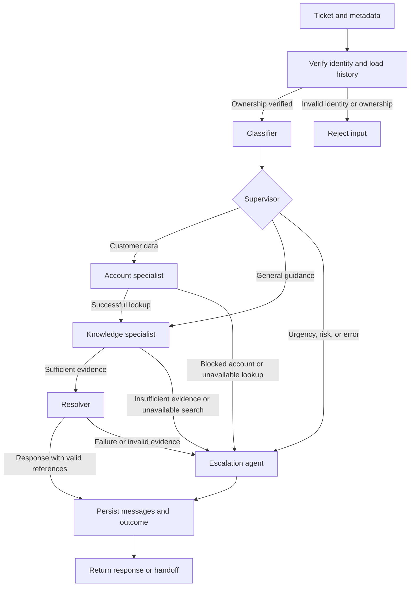

# UDA-Hub Architecture

Proposal for review under [ROB-37](https://linear.app/deltaedgeai/issue/ROB-37). The first delivery handles CultPass support tickets locally. It answers using evidence from the knowledge base and customer records when needed, or prepares a handoff to human support. The [acceptance matrix](aceite.md) defines how to demonstrate the behavior described here.

## Architecture choice

The proposed pattern is a **Supervisor**, implemented as a `StateGraph` built from scratch in `agentic/workflow.py`. The supervisor applies routing rules to the structured classification, ticket metadata, and retrieved evidence. Each route can be tested with controlled inputs and compared with the route observed in a demo.

A supervisor that lets the model delegate freely could explore more paths. For the initial CultPass release, the categories and two outcomes fit explicit transitions. The code enforces risk and data access rules. The agents interpret the message, select evidence, and draft the response or handoff summary.

The demo uses the local interface and examples from chat and email, with the same input contract for both channels. The application records the escalation decision for human review. External connectors, financial operations, changes to CultPass records, and MCP are outside the proposed scope.

## Agents and workflow

| Agent | Responsibilities and boundaries |
| --- | --- |
| Classifier | Interprets the message and conversation context. Returns the category, complexity, and a list of intents with structured search terms for each. Initial categories include account access, subscriptions and billing, reservations, technical support, and unknown. |
| Knowledge specialist | Searches the organization's articles by topic, ranks the candidates, and returns excerpts, identifiers, and relevance scores. |
| Account specialist | Looks up account and subscription status when the request involves data about the customer whose identity was verified in the simulation. Returns structured facts to the resolver. |
| Resolver | Drafts the response from the retrieved articles. When the route calls a tool, it adds facts from the authorized lookup and references the article that supports the guidance. |
| Escalation agent | Produces a customer message and a separate handoff summary for human support with the reason, actions attempted, and information still needed. |

The supervisor routes high-urgency tickets, sensitive action requests, and explicit requests for human support directly to escalation. General questions go to the knowledge specialist. Account-specific requests go to the account specialist first, followed by article retrieval. Failure of a required tool, missing evidence, and classification or generation failures trigger escalation with an explicit reason. If the model is unavailable, the escalation agent uses a template with the category, reason, and lookups performed.

## Contract and state

The normalized input contains `account_id`, `ticket_id`, `turn_id`, the message text, channel, urgency, receipt date, and `external_user_id`. The `account_id` identifies the organization supported by UDA-Hub. In the local demo, the operator selects a preregistered synthetic profile. The interface resolves the organization and customer identity independently of the message and passes that context to the workflow. New tickets are linked to that identity. When a ticket is resumed, the service checks ownership in UDA-Hub before loading state or calling tools. The interface rejects unknown profiles and tickets owned by someone else. Identifiers entered in a message are treated as text. Selecting a profile simulates the identity provided by a support integration.

Graph state contains the session messages and the current turn's classification, route, evidence, tool results, and outcome. Transient fields reset on each turn. The output includes a `resolved` or `escalated` status, the customer response, references to the articles used, and the relevance score when available. Escalated results also include the reason and a summary for support. Input or persistence failures are reported to the interface as operational errors. The interface shows a ticket as resolved only after persistence has been confirmed.

## Knowledge retrieval and confidence

The specialist queries the `Knowledge` table by `account_id`. For this small corpus, rank articles in memory separately for each intent, using its distinct normalized terms from the classifier. The classifier can expand terms using predefined synonyms for each category. For each article and intent, divide the number of matching query terms in the title, tags, or content by the number of terms for that intent. Ties favor title and tag matches, with the article ID as the final tie-breaker. Pass up to three candidates per intent with their title, content, ID, and score. Different intents can use different articles.

The proposed initial threshold is **0.60**, subject to calibration against the rubric examples. An empty query or an intent with no candidates scores zero. Escalate if any intent lacks a candidate at or above the threshold. For each identified intent, the resolver selects a qualifying article and quotes an excerpt that supports the guidance. The code checks that the article met the threshold for that intent, that the excerpt appears in that article, and that every intent has evidence. If the evidence covers only part of the request, the agent prepares a handoff that identifies what remains unresolved. The acceptance scenarios also check whether the cited excerpts support the expected guidance.

The [retrieval subgraph](../agents/knowledge.py) takes `account_id` and a list of intents with search terms. It returns ranked candidates grouped by intent. The `ready` status means all intents meet the relevance threshold. `insufficient_evidence` and `unavailable` let the supervisor distinguish evidence gaps from a failed database lookup.

The resolver receives only the retrieved articles and the authorized facts necessary for the case. The response uses validated excerpts and structured tool fields. Ticket text, history, and article content are treated as data. The initial customer preference is response format. The application applies the customer's choice of a concise or step-by-step response when rendering the output. Support policies come from the current knowledge base.

For verified customer-specific facts, use the lookup result. If a plan article lists four experiences per month and `lookup_subscription` returns seven for the verified customer, report seven as that customer's quota. Use the article for applicable general guidance and omit the conflicting generic amount from the personalized answer. If the required lookup fails or the applicable policy remains unclear, escalate.

## Support tools and data

| Tool | Source | Expected result |
| --- | --- | --- |
| `lookup_account` | `User` in CultPass SQLite | Customer identifier and account status, including whether the account is blocked. |
| `lookup_subscription` | The customer's `Subscription` in CultPass SQLite | Status, plan, and monthly quota when the customer has a subscription. |

The tools receive the identity verified by the service, validate their inputs, and return `ok`, `not_found`, `invalid_input`, `forbidden`, or `unavailable`, with defined fields for each result. A registered customer without a subscription receives `ok` with `has_subscription=false`. The resolver can report that fact when an applicable article is available. The `not_found` status means the identity has no CultPass record and leads to escalation when the lookup is required. Data access and SQLAlchemy queries live in `agentic/tools/`. A blocked account leads to escalation. The interface supplies both database paths when building the graph, with defaults relative to the package root and resolved from the application file.

The `01_external_db_setup.ipynb` and `02_core_db_setup.ipynb` notebooks create the CultPass and UDA-Hub SQLite databases in separate directories. The knowledge base contains four original starter articles and 16 project-authored examples covering technical support, billing, account management, and reservations. Tests use deterministic synthetic data in place of the randomly generated values from the CultPass notebook.

## Sessions, persistence, and traceability

- **Turn state.** LangGraph passes classifications, messages, evidence, and actions between nodes. The checkpoint uses a `thread_id` derived internally from the organization and ticket. It lets reviewers inspect the turn's messages and tool calls through the test session. The proposal uses a SQLite checkpointer to persist sessions in a local environment with serial writes.
- **History and long-term memory.** `Ticket`, `TicketMetadata`, and `TicketMessage` store history and outcomes in the UDA-Hub SQLite database. A proposed preferences table keyed by organization and customer stores explicit response format choices. A new ticket can load preferences and summaries of resolved cases from the same customer, including after a restart. The query is scoped to that customer's history.
- **Turn persistence.** Messages and outcomes are recorded before the application returns the output. A turn key scoped to the ticket lets the service retrieve an already saved response when a turn is retried. The checkpoint holds session state, and the UDA-Hub database records completed turns. After a restart without checkpoints, the application can recover persisted messages.
- **Logs.** JSON events for each node include internal run, ticket, and turn IDs, along with the category, route, tool, outcome, score, and escalation reason where applicable. Searching by `ticket_id` or `turn_id` reconstructs the full trace. Provider configuration stays in the local environment and history stays in the UDA-Hub database. Diagnostic logs contain identifiers and structured results.

## Delivery and validation

Development and the planned GitHub submission use the repository root. A clean checkout must contain the code, setup notebooks, seed data, versioned dependencies, tests, these documents, and run instructions. The Python environment and databases are created locally. The application will have a documented entry point in the checkout. The course instructions specify a `solution/` folder. Acceptance of the repository-root layout is pending confirmation before submission.

Tests will use controlled model responses and temporary databases to verify routes and failure cases without credentials. The academic demo will also exercise the configured provider with fictional tickets from the [acceptance matrix](aceite.md). The SQLite checkpoint dependency and final versions will be pinned after validating the implementation.
