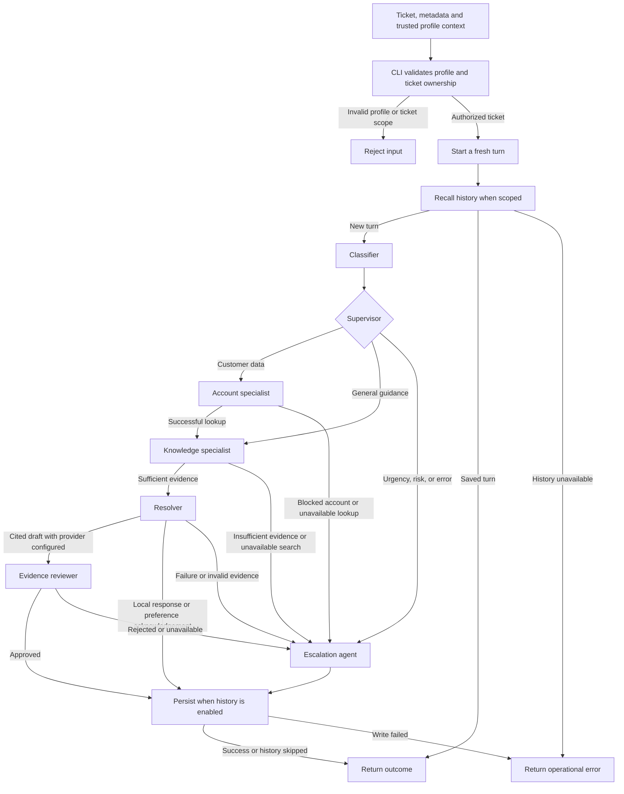

# UDA-Hub Architecture

The UDA-Hub handles CultPass support tickets using articles and authorized account facts. It produces a cited response or prepares a handoff to human support. The [acceptance matrix](aceite.md) describes how to verify the workflow.

## Architecture choice

The **Supervisor** pattern is implemented as a `StateGraph` in [workflow.py](../workflow.py). The supervisor applies routing rules to the structured classification, ticket metadata, and retrieved evidence. The agents interpret the message, select evidence, and draft the response or handoff summary. Explicit transitions enforce risk and data access rules.

The demo uses the local interface and examples from chat and email, with the same input contract for both channels. The application records the escalation decision for human review. External connectors, financial operations, changes to CultPass records, and MCP are outside the proposed scope.

## Agents and workflow

| Agent | Responsibilities and boundaries |
| --- | --- |
| Classifier | Interprets the message and conversation context. Returns intents with categories, search terms, and indicators for sensitive operations, human support, and account data. |
| Knowledge specialist | Searches the organization's articles by topic, ranks the candidates, and returns excerpts, identifiers, and relevance scores. |
| Account specialist | Looks up account and subscription status when the request involves data about the customer whose identity was verified in the simulation. Returns structured facts to the resolver. |
| Resolver | Drafts the response from the retrieved articles. When the route calls a tool, it adds facts from the authorized lookup and references the article that supports the guidance. |
| Evidence reviewer | Optionally asks OpenAI for a structured verdict on the local draft using the quoted excerpts and authorized facts. |
| Escalation agent | Produces a template-based handoff for human support with the reason, topics, and actions performed. |

The supervisor routes high-urgency tickets, sensitive action requests, and explicit requests for human support directly to escalation. General questions go to the knowledge specialist. Account-specific requests go to the account specialist first, followed by article retrieval. Failure of a required tool, missing evidence, and classification or generation failures trigger escalation with an explicit reason. If the model is unavailable, the escalation agent uses a template with the category, reason, and lookups performed.

## Contract and state

The normalized input contains `account_id`, message text, optional channel and urgency, and optional ticket, turn and verified profile fields. The caller supplies the verified profile separately from the message. The CLI accepts a synthetic fixture ID to simulate a trusted connector. It validates the profile in CultPass and checks the authoritative ticket catalog before executing or inspecting the workflow. The first authenticated request for a new ticket creates its UDA-Hub ownership record. For tickets recorded by the older CLI, the history store can provide the original owner key. Ambiguous owner keys cause a rejection.

Graph state contains remembered turns and the current turn's classification, route, evidence, tool results, and outcome. The output reports the decision and its reason, plus a cited response or handoff when applicable. Relevance scores remain available in the retrieval result. With scoped history enabled, an unavailable store or a rejected turn write produces `operational_error`. A repeated turn ID can be submitted after storage is restored.

## Knowledge retrieval and confidence

The specialist queries the `Knowledge` table by `account_id`. For this small corpus, rank articles in memory separately for each intent, using its distinct normalized terms from the classifier. The classifier can expand terms using predefined synonyms for each category. For each article and intent, divide the number of matching query terms in the title, tags, or content by the number of terms for that intent. Ties favor title and tag matches, with the article ID as the final tie-breaker. Pass up to three candidates per intent with their title, content, ID, and score. Different intents can use different articles.

The proposed initial threshold is **0.60**, subject to calibration against the rubric examples. An empty query or an intent with no candidates scores zero. Escalate if any intent lacks a candidate at or above the threshold. For each identified intent, the resolver selects a qualifying article and quotes an excerpt that supports the guidance. The code checks that the article met the threshold for that intent, that the excerpt appears in that article, and that every intent has evidence. If the evidence covers only part of the request, the agent prepares a handoff that identifies what remains unresolved. The acceptance scenarios also check whether the cited excerpts support the expected guidance.

The [retrieval subgraph](../agents/knowledge.py) takes `account_id` and a list of intents with search terms. It returns ranked candidates grouped by intent. The `ready` status means all intents meet the relevance threshold. `insufficient_evidence` and `unavailable` let the supervisor distinguish evidence gaps from a failed database lookup.

The resolver receives only the retrieved articles and the authorized facts necessary for the case. The response uses validated excerpts and structured tool fields. Ticket text, history, and article content are treated as data. The initial customer preference is response format. The application applies the customer's choice of a concise or step-by-step response when rendering the output. Support policies come from the current knowledge base.

The initial resolver selects marked customer-facing excerpts from the ranked articles. General answers use the article's `Suggested phrasing` section. Personalized answers pair the lookup facts with a separate `Account guidance` excerpt. If none of the qualifying articles provides the required excerpt, the workflow reports insufficient evidence.

For verified customer-specific facts, use the lookup result. If a plan article lists four experiences per month and `lookup_subscription` returns seven for the verified customer, report seven as that customer's quota. Use the article for applicable general guidance and omit the conflicting generic amount from the personalized answer. If the required lookup fails or the applicable policy remains unclear, escalate.

## Support tools and data

| Tool | Source | Expected result |
| --- | --- | --- |
| `lookup_account` | `User` in CultPass SQLite | Status for the verified customer, including whether the account is blocked. |
| `lookup_subscription` | The customer's `Subscription` in CultPass SQLite | Status, plan, and monthly quota when the customer has a subscription. |

The tools receive the identity verified by the service, validate their inputs, and return `ok`, `not_found`, `invalid_input`, `forbidden`, or `unavailable`, with defined fields for each result. A registered customer without a subscription receives `ok` with `has_subscription=false`. The resolver can report that fact when an applicable article is available. The `not_found` status means the identity has no CultPass record and leads to escalation when the lookup is required. Data access and SQLAlchemy queries live in `agentic/tools/`. A blocked account leads to escalation. The current graph accepts a knowledge database path and an optional CultPass database path. The caller passes the verified customer context separately from the ticket text.

The `01_external_db_setup.ipynb` and `02_core_db_setup.ipynb` notebooks create the CultPass and UDA-Hub SQLite databases in separate directories. The knowledge base contains four original starter articles and 16 project-authored examples covering technical support, billing, account management, and reservations. Tests use deterministic synthetic data in place of the randomly generated values from the CultPass notebook.

## Sessions, persistence, and traceability

The separate optional SQLite history file stores customer messages, decisions, classified intents, and responses or handoffs. It scopes the data by organization, verified customer, and ticket. Current-session follow-ups can reuse the last resolved intents. A new ticket can use preferences and inspect recent resolved topics from the same customer. Completed turn IDs replay the stored outcome, including after process restart. Metadata-only rows retain their original information during schema upgrades.

LangGraph transfers turn state between nodes. For verified profiles, the CLI uses a separate SQLite checkpoint file and derives the `thread_id` from the authorized organization, profile, and ticket. It passes each new ticket as `turn_input`. The first node clears the previous turn's inputs and derived fields before applying the new inputs. The history node then loads the scoped conversation and preferences, including a saved outcome when the requested turn is a replay. The [CLI inspection command](../../README.md#inspect-a-session-checkpoint) shows the completed checkpoint for the authorized thread.

The CLI writes a local JSONL trace with the ticket and turn IDs, route decisions, retrieval scores and article IDs, tool statuses, provider verdict and final outcome. Replays record their final decision and `replayed` status. Ticket and turn IDs must be opaque strings. Event fields exclude credentials, identity details, messages, responses, and excerpts.

## Delivery and validation

The GitHub checkout places the project at the repository root. The upload archive uses the course template's `solution/` directory. The [CLI](../../03_agentic_app.py) runs the local workflow with optional OpenAI review. The [submission validator](../../validate_submission.py) cross-checks the architecture routes and exercises the technical rubric in a temporary copy.

Tests use controlled model responses and temporary databases to verify routes and failure cases without credentials. The [demo instructions](../../README.md#run-the-support-demo) cover review with the configured provider and log filtering. The [acceptance matrix](aceite.md) lists the expected outcomes.
